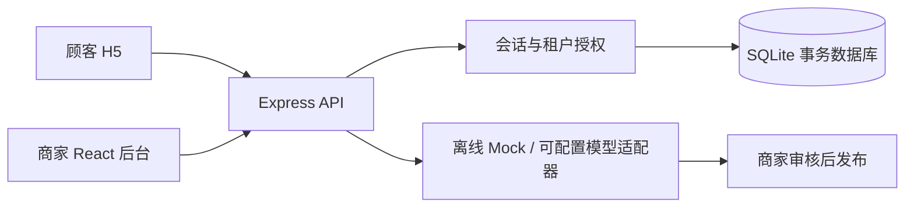

# 架构决策 · 2026-10-24

本项目采用最新启动包的路由和产品规格，旧交付包的安全验收项继续覆盖。附件是需求参考，外部联络、云资源、公开部署及收费不属于本次执行范围。

## 本地 MVP

React 19 + TypeScript + Vite 6 + Tailwind 4，Express 5 API；Node 24 原生 SQLite，磁盘持久化、WAL、外键、检查约束、BEGIN IMMEDIATE 事务。单仓库减少配置。当前机器没有 PostgreSQL/Docker，未发现 CloudBase 连接，因此 SQLite 是可验证的本地替代，不能把它标为已完成 CloudBase/PostgreSQL 集成。SQLite 不提供 RLS；当前隔离由服务端已验证会话、逐资源 tenant 条件和数据库复合外键执行。

真实本地密码验证（scrypt）、HttpOnly/SameSite 会话、CSRF token、Origin 检查、AES-GCM 联系方式加密。演示账号仅用于回环地址。禁止把本地演示直接开放到公网。

## 目录

`src/` 页面与组件；`server/` 身份/业务/API；`shared/` Zod 契约；`db/migrations/` 版本迁移；`tests/` 单元、接口、浏览器；`scripts/` 账号与备份；`docs/` 需求、运维和验收证据。

## 官方资料核验

- [CloudBase Codex 配置](https://docs.cloudbase.net/ai/cloudbase-ai-toolkit/ide-setup/codex)：本地或远程接入需用户账户授权，本次未安装全局插件或创建资源。
- [CloudBase PostgreSQL 权限](https://docs.cloudbase.net/database/postgresql/data-permission)：通过 RLS 和 auth.uid() 绑定身份。云端需重新验证 JWT、角色、直接数据库访问和事务。
- [CloudBase 快速开始](https://cloud.tencent.cn/document/product/876/121103)：Web 支持静态托管与后端服务。
- [Vite](https://vite.dev/guide/)、[Tailwind Vite 插件](https://tailwindcss.com/docs/installation/using-vite)、[Node SQLite](https://nodejs.org/docs/latest-v24.x/api/sqlite.html)：安装版本以 package-lock 为准；本机 DatabaseSync 已实际执行 SELECT sqlite_version() 成功。
- CloudBase getting-started 页面首次抓取超时；不据此宣称接入成功。

## 执行顺序

1. 身份、店铺、活动与公共页。
2. 摄影容量与餐饮原子发券/核销。
3. 文案审核、实际事件统计、分享和移动端。
4. lint/typecheck/unit/integration/E2E/build、备份恢复演练、截图和交付。
